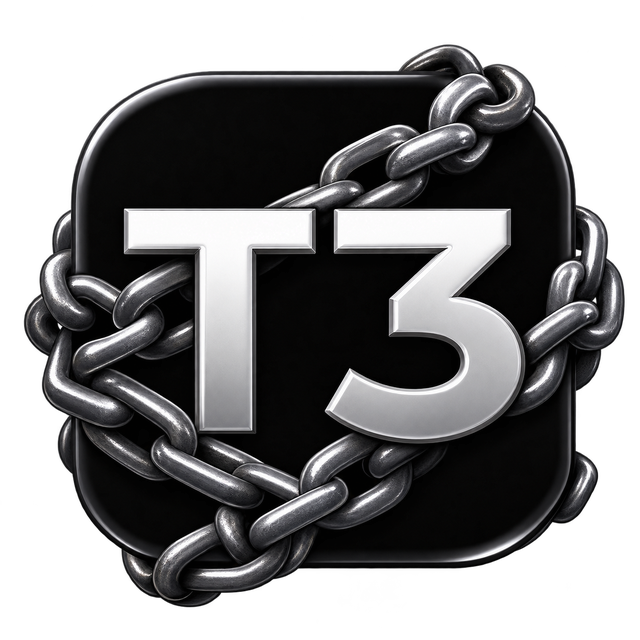

<p align="center">
  
</p>

<p align="center">
  <a href="t3code-lockdown"></a>
  &nbsp;
  <a href="LICENSE"></a>
</p>

<p align="center">
  <strong>English</strong> | <a href="README.zh-TW.md">繁體中文</a>
</p>

# t3code-lockdown

An Agent Skill that locks T3 Code down so it stops sending usage telemetry, cannot use T3 Connect, and does not auto-update — and **refuses to falsely report "safe"** when T3 Code hasn't restarted, a check was skipped, or T3 Code updated to an unaudited version or schema.

It works with any agent that supports the standard Agent Skills layout (`SKILL.md` plus optional `references/` and `scripts/`) with zero third-party dependencies.

## Highlights

- **Standard & Strict Profiles**:
  - `standard` (default): locks `limits.telemetry=false`, `limits.connect=false`, `limits.updates={mode:"off", allowNightly:false}` plus `T3CODE_TELEMETRY_ENABLED=false` and `T3CODE_OTEL_SDK_DISABLED=true`, keeping Tailscale remote access working.
  - `strict` (`--profile strict` / `-Profile Strict`): additionally locks `limits.webhookTasks=false`, `limits.browserCookieImport=false`, `limits.previewTunnel=false`, and `settings.enableProviderUpdateChecks={value:false, locked:true}`.
- **Fail-Closed 5-State Verdict Model** (with `--json` / `-Json` output):
  - `0` = `VERIFIED` (only state allowed to claim lockdown is active)
  - `10` = `PENDING_RESTART` (disk config valid, but T3 Code not running or hasn't reloaded policy/env)
  - `20` = `DRIFT_DETECTED` (unaudited T3 Code version or new ADMX policy fields / CLI subcommands detected)
  - `30` = `INCOMPLETE` (missing `t3` binary, unreadable runtime info, or WSL side not yet audited)
  - `1` = `FAIL` (missing/overridden config, MDM/GPO/WSL policy conflict, `t3 policy check` failure, `T3 Connect` not off, active `cloudflared`, or forbidden user setting)
- **Live Runtime & Update Drift Auditing**:
  - Auto-discovers `t3` (including WSL2's `~/.t3/wsl-runtime/sha256-*/t3`), pre-validates policies with `t3 policy check` before writing, verifies running server fingerprint & Linux/WSL `/proc/<pid>/environ`, checks `t3 status` and `cloudflared` (read-only, zero DNS lookups).
  - Compares live `t3 --version`, `t3 policy templates` ADMX schema, and `t3 --help` subcommands against [`t3code-lockdown/references/baseline.json`](t3code-lockdown/references/baseline.json), plus a `snapshot` mode for auditing future T3 Code releases.

Full workflow, Drift Triage Protocol, verification, and rollback are in [`t3code-lockdown/SKILL.md`](t3code-lockdown/SKILL.md).

## Install

Copy the `t3code-lockdown` folder into the skills directory your agent reads. Common locations include:

- Generic / multi-agent: `~/.agents/skills/t3code-lockdown`
- Claude Code: `~/.claude/skills/t3code-lockdown`
- Codex: `~/.codex/skills/t3code-lockdown`
- Cursor: the project's or the user's skills folder (the exact path depends on your Cursor version and settings)

Then start a new session, or reload skills in whatever way your agent expects.

```bash
git clone git@github.com:Gratia2533/t3code-lockdown.git
cp -R t3code-lockdown/t3code-lockdown ~/.agents/skills/t3code-lockdown
```

For HTTPS, clone `https://github.com/Gratia2533/t3code-lockdown.git` instead. This is a private repository, so the GitHub account you use needs access.

## Contents

- `t3code-lockdown/SKILL.md` — skill instructions, fail-closed verdict contract, and Drift Triage Protocol
- `t3code-lockdown/references/baseline.json` — audited T3 Code version, profile definitions, ADMX schema & CLI subcommand baseline
- `t3code-lockdown/scripts/lockdown.sh` — Linux / WSL2 / macOS (`apply` / `verify` / `rollback` / `snapshot`)
- `t3code-lockdown/scripts/audit_unix.py` & `audit_lib.py` — stdlib-only Python 3 audit, policy generation, and drift detection modules
- `t3code-lockdown/scripts/lockdown.ps1` & `audit_windows.ps1` — Windows PowerShell 5.1+ / 7+ (`Apply` / `Verify` / `Rollback` / `Snapshot`, `-CheckWsl`, `-Json`)
- `tests/` — automated test suite for Unix and PowerShell scripts (not needed when copying `t3code-lockdown/` into a skills folder)

Both scripts are idempotent, back up files before changing them, and never modify firewalls, hosts files, or running processes.

## Running Tests

```bash
python3 -m unittest discover -s tests -v
```

On Windows (or WSL with `powershell.exe` on PATH):

```powershell
powershell -ExecutionPolicy Bypass -File tests\test_lockdown_ps1.ps1
```

## License

Released under the [MIT License](LICENSE). Copyright (c) 2026 Gratia2533.
