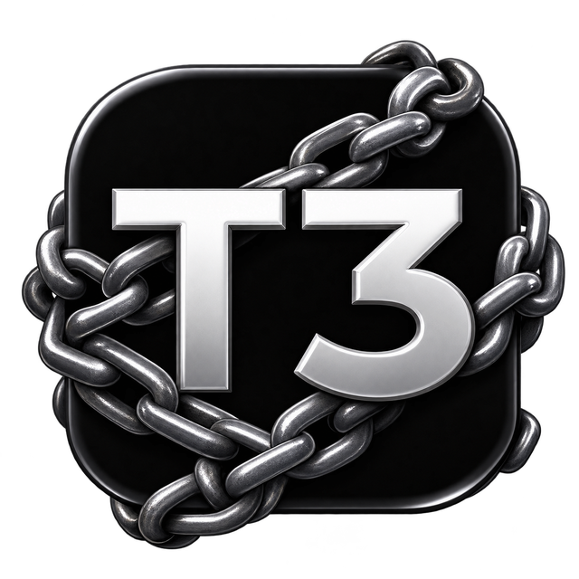

<p align="center">
  
</p>

<p align="center">
  <a href="t3code-lockdown"></a>
  &nbsp;
  <a href="LICENSE"></a>
</p>

<p align="center">
  <a href="README.md">English</a> | <strong>繁體中文</strong>
</p>

# t3code-lockdown

把 T3 Code 鎖到「不送遙測、不能用 T3 Connect、不自動更新」的 Agent Skill。適用任何支援標準 Agent Skills 格式（`SKILL.md` 加可選腳本）的代理，不綁定特定產品。

安裝後，請代理設定、檢查或還原某台機器的 T3 Code 隱私／遙測設定即可。完整步驟、驗證與 rollback 見 [`t3code-lockdown/SKILL.md`](t3code-lockdown/SKILL.md)。

## 安裝

把 `t3code-lockdown` 資料夾複製到你使用的代理會讀取的 skills 目錄。常見位置例如：

- 通用／多代理：`~/.agents/skills/t3code-lockdown`
- Claude Code：`~/.claude/skills/t3code-lockdown`
- Codex：`~/.codex/skills/t3code-lockdown`
- Cursor：專案或使用者的 skills 資料夾（實際路徑依 Cursor 版本與設定為準）

複製後請開新 session，或依該代理的方式重新載入 skills。

```bash
git clone git@github.com:Gratia2533/t3code-lockdown.git
cp -R t3code-lockdown/t3code-lockdown ~/.agents/skills/t3code-lockdown
```

HTTPS 的話把 clone 網址改成 `https://github.com/Gratia2533/t3code-lockdown.git`。這是私有倉庫，需要有權限的 GitHub 帳號。

## 內容

- `t3code-lockdown/SKILL.md`：skill 說明與操作步驟
- `t3code-lockdown/scripts/lockdown.sh`：Linux／WSL／macOS（`apply`／`verify`／`rollback`）
- `t3code-lockdown/scripts/lockdown.ps1`：Windows

兩個腳本皆為冪等：重複執行只會顯示 `unchanged`，並在修改前備份。

## 授權

以 [MIT License](LICENSE) 釋出。Copyright (c) 2026 Gratia2533。
